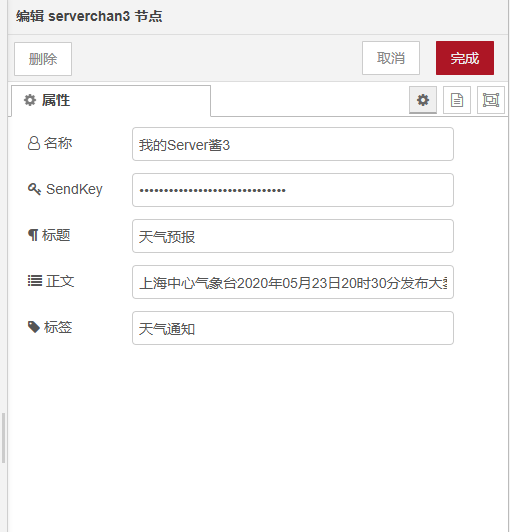
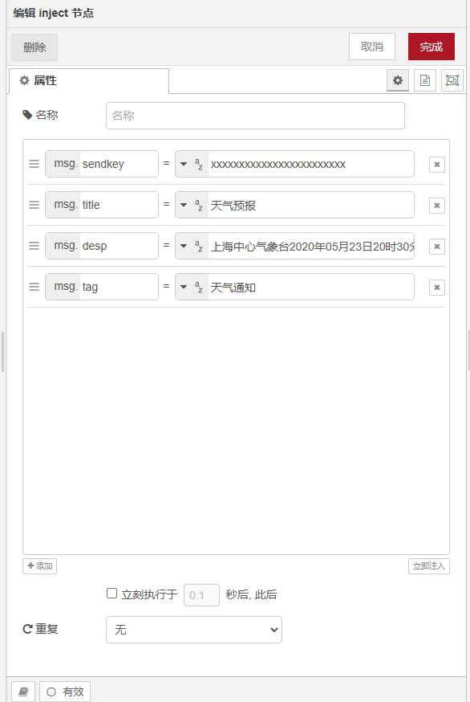

# Node-red node for ServerChan3( server酱3极简推送服务 )

## 使用说明

1. 访问 <https://sc3.ft07.com> 注册获得 SendKey，下载APP,大部分手机无需驻留后台可收到消息

1. 配置 `msg.sendkey` ， `msg.title` ， `msg.desp` 即可推送消息到手机

## (2026-11-19新增）Server酱MAX（内测）

内测网址：https://max.ft07.com/

无需改界面配置：直接在服务配置里填 MAX 版 SendKey 即可自动识别。

- MAX 版 SendKey 以 `scx-` 开头，格式为 `scx-<用户ID>-<密钥>`，例如 `scx-10331-...`
- 节点会取短横杠之间的用户 ID，请求 `https://<用户ID>.max.ft07.com/v1/send`，并以 `Authorization: Bearer <完整 SendKey>` 发送 `{"title": ..., "desp": ..., "tags": [...]}`（标签为空时不带 `tags` 字段）
- 其他 SendKey 保持原有 `serverchan-sdk` 方式不变

